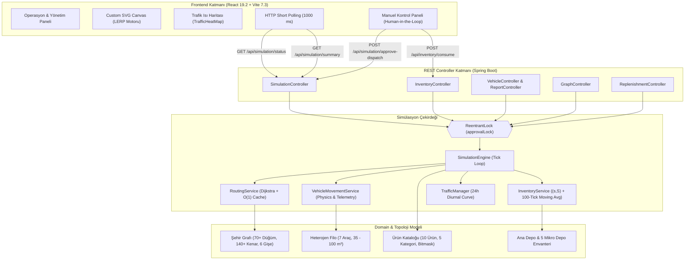

# 🚚 LogiSim-DSS: Otonom Lojistik & Çok-Depolu Karar Destek Simülatörü

<div align="center">


**E-Ticaret ve hızlı teslimat lojistiğinde çok-kademeli dağıtım ağlarını, dinamik envanter ikmalini, rota sapma kısıtlarını ve araç atamalarını gerçek zamanlı simüle eden deterministik karar destek sistemi.**

[Özellikler](#-öne-çıkan-özellikler) • [Sistem Mimarisi](#-sistem-mimarisi) • [Algoritmik ve Matematiksel Modeller](#-algoritmik-ve-matematiksel-modeller) • [Ağ ve Filo Topolojisi](#-coğrafi-ağ-ve-filo-topolojisi) • [Ürün Kataloğu](#-ürün-kataloğu-ve-kargo-kategorileri) • [REST API](#-kapsamlı-rest-api-referansı) • [Arayüz Modülleri](#-frontend-arayüz-modülleri) • [Test ve Doğrulama](#-test-güvenilirliği-ve-doğrulama-matrisi) • [Bilinen Sınırlar ve Hata Bildirimi](#-bilinen-sınırlar-varsayımlar-ve-hata-bildirimi) • [Kurulum](#-kurulum-ve-çalıştırma)

</div>

---

## 📌 Problem ve Proje Amacı

Geleneksel lojistik planlama yazılımları statik ve deterministik olmayan varsayımlarla çalışır. Ancak gerçek dünya kentsel lojistiğinde:
* **Öngörülemez Talep:** Mikro depolarda tüketim anlık ve tahmin edilemez şekilde dalgalanır; statik emniyet stoğu formülleri ya stoksuzluğa (stockout) ya da atıl sermaye birikimine yol açar.
* **Dinamik Trafik ve Gişe Maliyetleri:** Trafik yoğunluğu günün saatine (Rush-Hour) göre kenar ağırlıklarını değiştirir; otoyol ve köprü geçiş ücretleri araç türüne (ağır vasıta farkı) göre toplam sevkiyat kârlılığını doğrudan etkiler.
* **Açgözlü (Greedy) Filo Kilitlenmesi:** Açgözlü atama mekanizmaları, sisteme ilk düşen 5 m³'lük küçük bir koli için filodaki 85 m³'lük tırı depoya bağlayarak büyük sevkiyatları açıkta bırakır ve filoyu kilitler.
* **Fiziksel ve Yasal Kısıtlar:** Soğuk hava zinciri, derin dondurucu veya reçeteli tıbbi ürün kısıtları her aracın her kargoyu taşımasına izin vermez.
* **Operatör Güvensizliği ve Deadlock:** Düşük doluluklu araçların erken saatlerde haksız yere sevk edilmesi yüksek operasyonel zarar üretirken; hiç çıkış yapamaması yüklerin depoda rehin kalmasına (starvation/deadlock) sebep olur.

**LogiSim-DSS**, bu kısıtları 1 dakikalık zaman adımlarıyla (tick-based) modelleyen; **Dinamik Ağırlıklı Dijkstra**, **100-Tick Kayan Pencereli (s, S) Envanter Politikası**, **Best-Fit Hacim Sezgiseli**, **Anti-Starvation Koridor Bölüştürme**, **Gezgin Satıcı (TSP) Çoklu Durak Konsolidasyonu** ve **Human-in-the-Loop** onay mekanizmalarını tek bir reaktif platformda birleştiren akademik ve endüstriyel bir Karar Destek Sistemidir.

---

## ✨ Öne Çıkan Özellikler

* **⏱️ Deterministik Tick-Based Simülasyon Motoru:** Gerçek dünya zamanını 1-dakikalık adımlarla sıkıştırarak çalıştıran (`TICK_MINUTES = 1L`), tekrarlanabilir ve bilimsel testlere olanak tanıyan çekirdek motor.
* **🔒 Thread-Safe Eşzamanlılık (`ReentrantLock`):** Simülasyon motorunun karar döngüsü ile REST API üzerinden gelen operatör müdahalelerini (`approvalLock`) veri çakışmasız (race-condition-free) yöneten mimari.
* **📦 Dinamik Baseline & $(s, S)$ İkmal Politikası:** 100-tick kayan pencerede hareketli ortalama (Moving Average) hesaplayarak tüketim trendi değiştikçe hedef stok seviyesini ($S$) artıran/azaltan, yoldaki stokları (`incomingQuantity`) hesaba katarak çift siparişi (double-ordering) önleyen adaptif envanter kontrolü.
* **🚚 Best-Fit Araç Seçimi & Atıl Hacim Cezası:** Boş kalan her $1\text{ m}^3$ hacim için $0.25$ ceza puanı uygulayan, açgözlü filo seçimini engelleyen ve büyük tırları küçük yüklere rehin bırakmayan optimizasyon.
* **🛡️ Sınırlı Bekleme İndirimi (Aging Cap = 10 Puan):** Depoda bekleyen araçlara dakika başı $1.5$ puan bekleme teşviki verirken, bunu maksimum $10$ puan ile sınırlandırarak Best-Fit kuralının aşılmasını önleyen mimari.
* **🌐 Paralel Koridor Dağıtımı (Anti-Starvation Partitioning):** Bir araç bir coğrafi koridoru (örn: Doğu koridoru / M1) konsolide etmek için sahiplendiğinde (`claimedRequestIds`), diğer boş aracın bağımsız olarak Batı koridoruna (M2) yönelmesini sağlayan talep bölüştürme mekanizması.
* **⚡ $O(1)$ Bitmask Yetenek ve Kategori Filtresi:** Soğuk zincir (`COOLED_BOX`), derin dondurucu (`DEEP_FREEZE`), hassas koli rafı (`FRAGILE_RACK`), kilitli medikal kasa (`MEDICAL_LOCK`) gibi ürün isterlerini bitwise AND/OR seviyesinde süzen yüksek performanslı güvenlik bariyeri.
* **🗺️ Dinamik Ağırlıklı Dijkstra & Akıllı Route Cache:** Değişen 24 saatlik trafik katsayılarına, 6 adet otoyol/köprü gişe ücretine ve ağır vasıta çarpanına ($\times 1.35$) göre en düşük maliyetli rotayı hesaplayan, aynı trafik durumundaki mükerrer hesaplamaları $O(1)$ sürede dönen `ConcurrentHashMap` rota önbelleği.
* **🔀 %35 Sabit Rota Sapması & TSP Çoklu Durak Konsolidasyonu:** Yolda giderken ek mikro depolara uğrayıp yük toplamayı sağlayan Gezgin Satıcı permütasyon optimizasyonu, değerli kargolara tanınan finansal sapma bonusu (`totalValue / 100.0`) ve tezin onaylı sabit %35 sapma kuralı.
* **🛑 Kademeli SLA Eşikleri & Finansal Zarar Uyarılı Force Dispatch:** 5 saatlik (300 tick) doğal konsolidasyon toleransı sonrasında karesel tırmanan aging skoruyla mesai bitimi (Aging $\ge 600 - 800$) operatör onay mekanizması; %5 dolulukta aracın kilitlenmesini finansal zarar ikazıyla çözen kurtarma sübabı.
* **🎨 Segment-Based LERP Animasyonu:** Üçüncü parti harita kütüphanelerine (Leaflet/Mapbox) bağımlılık olmadan, saf HTML5/SVG Canvas üzerinde araçların koordinatlarını lineer interpolasyon (LERP) ile 60 FPS pürüzsüz akıtan reaktif arayüz.
* **🌱 Sürdürülebilirlik & CO2 Emisyon Analitiği:** Elektrikli araçların ($0.0\text{ kg CO}_2/\text{km}$), benzinli ($0.7\text{ kg CO}_2/\text{km}$) ve dizel araçların ($0.8\text{ kg CO}_2/\text{km}$) emisyonlarını takip edip dizel baz çizgisine göre net kurtarılan CO2 miktarını hesaplayan çevresel raporlama.

---

## ⚙️ Sistem Mimarisi



---

## 🧠 Algoritmik ve Matematiksel Modeller

### 1. Dinamik Ağırlıklı Dijkstra ve Rota Maliyeti
Bir kenarın ($u, v$) anlık seyahat maliyeti baz mesafe, günün saatine göre değişen trafik çarpanı ve otoyol/köprü geçiş ücretinin ağırlıklı toplamıdır:

$$\text{Weight}(u, v) = \left(\text{Distance}_{uv} \times \text{TrafficMultiplier}(t)\right) + \text{TollCost}_{uv} \times \text{VehicleTollMultiplier}$$

* **Ağır Vasıta Gişe Çarpanı:** Ağır vasıtalar (kamyon ve tırlar) için gişe ücreti $\times 1.35$ çarpanı ile hesaplanır (`HEAVY_VEHICLE_TOLL_MULTIPLIER = 1.35`).
* **Akıllı Rota Önbelleği (Intelligent Route Cache):** `(source, target, trafficGeneration)` anahtarıyla tutulan `ConcurrentHashMap`, aynı trafik neslindeki tekrarlı sorguları $O(1)$ karmaşıklıkta döner. Trafik katsayısı değiştiğinde `trafficGeneration` artırılarak önbellek atomik olarak geçersiz kılınır.

---

### 2. Dinamik Baseline ve $(s, S)$ İkmal Modeli
Mikro depodaki bir ürünün tüketim geçmişi 100-tick'lik kayan pencerede izlenir:

$$\text{MovingAverage} = \frac{1}{N} \sum_{i=1}^{N} \text{Consumption}_i \quad (N = 100)$$

$$\text{TargetLevel } (S) = \lceil \text{MovingAverage} \times 1.2 \rceil$$

İkmal tetikleme ve talep formülü:
* Mevcut stok $s \le 40$ birimin (`AUTO_REPLENISH_TRIGGER`) altına indiğinde ikmal ihtiyacı oluşur.
* Hedef seviye $S = 80$ birimdir (`AUTO_REPLENISH_TARGET`).
* Net talep hesabı:
  $$\text{Talep} = \max\left(0, \ S - (\text{Mevcut Stok} + \text{Yoldaki Stok})\right)$$
* Yoldaki ikmaller (`incomingQuantity`) doğrudan hesaba dahil edildiği için mükerrer siparişler (double-ordering) tamamen engellenir.

---

### 3. Best-Fit Araç Seçimi ve Sınırlı Bekleme İndirimi
Bir aracın yük için seçim maliyeti, boş kalan kapasiteye verilen atıl hacim cezası ve bekleme süresi indirimiyle hesaplanır:

$$\text{wastePenalty} = \max\left(0.0, \ (\text{Kapasite} - \text{Yük Hacmi}) \times 0.25\right)$$

$$\text{selectionCost} = \text{wastePenalty} - \min(10.0, \ \text{waitedTicks} \times 1.5)$$

* **Atıl Hacim Cezası ($0.25$ puan/$\text{m}^3$):** 5 m³'lük küçük bir sipariş geldiğinde 85 m³'lük tır $20.0$ ceza puanı alırken, 35 m³'lük araç yalnızca $7.5$ ceza puanı alır.
* **Bekleme İndirimi Tavanı (Cap = 10 Puan):** Tır ne kadar uzun süre beklerse beklesin alabileceği bekleme indirimi 10 puanı geçemez (`MAX_AGING_DISCOUNT = 10.0`). Bu sayede Best-Fit kuralı asla delinmez ve tır küçük yüklere rehin edilemez.
* **Konsolidasyon Esnekliği:** Tır çoklu duraklarla mikro depolardan ek sipariş topladıkça boş hacmi azalır, `wastePenalty` düşer ve büyük sevkiyatları doğal olarak üstlenir.

---

### 4. 5 Saatlik Konsolidasyon Penceresi ve Kademeli SLA Onay Matrisi
Düşük doluluklu araçların erken saatlerde haksız yere sevk edilmesini veya depoda sonsuza kadar kilitlenmesini önleyen tolerans modeli:

$$\text{overdueTicks} = \max\left(0L, \ t_{\text{waited}} - 300L\right) \quad \text{(İlk 300 dk / 5 Saat Grace Period)}$$

$$\text{agingScore} = \min\left(1000.0, \ (\text{overdueTicks})^2 \times 0.02\right)$$

| Doluluk Oranı | Grace Period ($T_{\text{grace}}$) | Otonom Çıkış? | Operatör Onayı Açılma Eşiği | Davranış & Açıklama |
| :--- | :---: | :---: | :--- | :--- |
| **%75 - %100** | 0 dk | **EVET (Anında)** | Gerek yok | Optimum doluluk; beklemeden anında sevk edilir. |
| **%50 - %74** | 180 dk (3 saat) | **EVET (180 dk sonra)** | 90. dakikada erken onaylanabilir | 3 saat konsolidasyon bekler; dolmazsa otonom çıkar. |
| **%20 - %49** | 300 dk (5 saat) | **HAYIR** | **Aging $\ge 600$ (~8. Saat / Mesai Sonu)** | 5 saat tolerans sonrası gün sonunda manuel onayla çıkar. |
| **%10 - %19** | 300 dk (5 saat) | **HAYIR** | **Aging $\ge 800$ (~8.3 Saat)** | Kritik düşük yük onayıyla mesai bitimi çıkarılır. |
| **< %10 (Örn: %5)**| 300 dk (5 saat) | **HAYIR** | **Aging = 1000 (Finansal Zarar Uyarısı)** | Deadlock koruması: Operatör zararına sevki görerek onaylar. |

---

### 5. Multi-Stop Rota Sapması ve Gezgin Satıcı (TSP) Konsolidasyonu
Bir araç yola çıktığında rota üzerindeki diğer depolardan ek sipariş alabilir. Ancak sapma sınırsız değildir:

$$\text{valueBonusKm} = \min\left(60.0, \ \frac{\text{Toplam Kargo Finansal Değeri}}{100.0}\right)$$

$$\text{maxBypassKm} = (\text{Ana Rota Mesafesi} \times 0.35) + \text{valueBonusKm} + 15.0\text{ km}$$

* **%35 Sabit Tolerans:** Tezin onaylı formülü gereği rota sapma oranı %35 ile sınırlandırılmıştır (`MULTI_STOP_DEVIATION_RATIO = 0.35`); mantıksız zikzaklar engellenir.
* **Gezgin Satıcı Permütasyon Motoru:** Eklenen her durak için durakların tüm permütasyonları taranarak en kısa mesafeli teslimat sırası (`generatePermutations`) bulunur.

---

### 6. Bir Yükün Araca Atanma Mimarisi (7 Aşamalı Karar Motoru)

Sistemdeki hiçbir yük rastgele bir araca verilmez; 7 aşamalı katı bir filtreden geçer:
1. **Güvenlik ve Yetenek Maskesi Kontrolü:** Aracın `capabilityMask` değeri ile kargonun `requiredCapabilities` maskesi bitwise AND seviyesinde test edilir (`CapabilityMasks.vehicleCoversRequiredMask`). Eşleşmiyorsa araç anında elenir.
2. **Kategori Uyumu:** Aracın desteklediği kategoriler (`supportsCategories`) kargoyu içeriyor mu?
3. **Ana Depo Stok Rezervi:** Sevk edilecek ürün ana depoda fiziksel olarak mevcut mu (`inventoryService.hasEnoughAvailable`)?
4. **Hacim ve Ağırlık Kapasitesi:** Kargo hacmi ve ağırlığı aracın kalan boş alanına sığıyor mu?
5. **Rota Sapma Toleransı:** Yeni durağın eklenmesi %35 sapma kuralını aşıyor mu?
6. **TSP Rota Sıralaması:** En düşük mesafeli durak permütasyonu çıkarılır.
7. **Best-Fit ve Bekleme Skoru Sıralaması:** En düşük `selectionCost` değerine sahip araç görevi üstlenir.

---

### 7. Finansal Maliyet ve Kârlılık Metrikleri

* **Yakıt Maliyeti:** $\text{totalRoundTripDistance} \times \text{costPerKm}$
* **Gişe Maliyeti:** $\sum \text{tollCost} \times (1.35 \text{ if HEAVY else } 1.0)$
* **İşçilik ve Elleçleme Maliyeti:** Durak başına elleçleme süresi (`LABOR_RATE_PER_TICK = 0.55`) + zaman maliyeti (`TIME_COST_WEIGHT = 0.35`).
* **Ceza Maliyetleri:** SLA aşım gecikme cezası (`DELAY_PENALTY_WEIGHT = 0.08`) + depo stoksuzluk cezası (`STOCKOUT_PENALTY_WEIGHT = 2.5`).
* **Fayda-Maliyet Oranı (BCR / ROI):**
  $$\text{BCR} = \frac{\text{Toplam Kargo Değeri}}{\text{Toplam Operasyonel Maliyet}}$$
* **Sürdürülebilirlik (CO2 Tasarrufu):** Elektrikli araçlar 0 g/km salınım yaparken; Dizel araçların 0.8 kg/km baz çizgisiyle ne kadar karbon salınımından tasarruf edildiği net olarak raporlanır.

---

## 🗺️ Coğrafi Ağ ve Filo Topolojisi

### 1. Düğüm ve Altyapı Dağılımı
Simülasyon, 1000×1000 koordinat düzleminde modellenmiş zengin ve organik bir şehir ağı üzerinde koşar:
* **1 Ana Lojistik Merkezi (Hub):** `MAIN` (80, 120) — Kuzeybatı sanayi bölgesinde yer alır; tüm ikmal buradan başlar.
* **5 Mikro Depo:**
  * `M1` (430, 145) — Kuzey-Merkez Koridoru
  * `M2` (560, 780) — Güney Bölgesi
  * `M3` (820, 390) — Doğu Bölgesi
  * `M4` (140, 620) — Batı Bölgesi
  * `M5` (490, 460) — Şehir Merkezi
* **48 Kavşak Düğümü:** `J1` - `J48` (Organik kavşak ağları).
* **8 Çıkmaz Sokak / T-Kavşak:** `D1` - `D8` (Hızlı bağlantı ve dönüş düğümleri).
* **16 Müşteri Talep Noktası:** `C1` - `C16` (Kavşaklara bağlı dinamik tüketim noktaları).
* **Yol Ağı:** 140'tan fazla çift yönlü kenar (`Edge`).

### 2. Ücretli Yollar, Köprüler ve Tüneller (Toll Passages)
Dijkstra rotalamasını doğrudan etkileyen ve otoyol/köprü geçiş maliyeti üreten 6 stratejik geçiş noktası:

| Geçiş Adı | Başlangıç - Bitiş | Mesafe | Baz Gişe Ücreti | Ağır Vasıta Ücreti ($\times 1.35$) | Açıklama |
| :--- | :---: | :---: | :---: | :---: | :--- |
| **Kuzey Otoyolu** | `MAIN` ↔ `J5` | 3.0 km | 60.00 ₺ | 81.00 ₺ | Ana depodan kuzey mikro deposuna hızlı transit |
| **Doğu Çevre Yolu** | `J14` ↔ `J20` | 3.2 km | 85.00 ₺ | 114.75 ₺ | Doğu koridorunu şehre bağlayan ekspres otoyol |
| **Boğaz Köprüsü** | `J18` ↔ `J22` | 2.8 km | 145.00 ₺ | 195.75 ₺ | Doğu-Merkez aksını bağlayan stratejik köprü |
| **Güney Ekspres** | `J28` ↔ `J45` | 2.0 km | 55.00 ₺ | 74.25 ₺ | Güney koridoru kestirme bağlantısı |
| **Batı Otoyolu** | `J38` ↔ `J36` | 1.5 km | 25.00 ₺ | 33.75 ₺ | Batı bölgesi hızlı erişim arteri |
| **Merkez Tüneli** | `J12` ↔ `J16` | 1.8 km | 45.00 ₺ | 60.75 ₺ | Şehir merkezini transit geçen yeraltı tüneli |

### 3. Heterojen Filo Özellikleri (Kodda Tanımlı 7 Araç)

| Araç Kodu | Tip & Rol | Kapasite | Yakıt Türü | Birim Maliyet | Desteklenen Kategoriler | Donanım Yetenekleri |
| :--- | :--- | :---: | :---: | :---: | :--- | :--- |
| `EXPRESS-MASTER` | Hızlı Dağıtım | 50.0 m³ | Benzin | 7.80 ₺/km | Medikal, Elektronik, Gıda | Standart Kutu, Medikal Kilit, Soğutmalı Kasa |
| `ECO-TRANSIT` | Hafif Ticari / Eko | 35.0 m³ | Elektrikli | 2.40 ₺/km | Gıda, Genel, Temizlik, Elektronik | Standart Kutu, Kırılabilir Raf |
| `HEAVY-CARRIER` | Ağır Tır | 85.0 m³ | Dizel | 8.55 ₺/km | Gıda, Temizlik, Genel, Medikal | Standart Kutu, Derin Dondurucu, Soğutmalı Kasa |
| `CITY-RUNNER` | Şehir İçi Dağıtım | 45.0 m³ | Benzin | 7.20 ₺/km | Elektronik, Genel, Gıda | Standart Kutu, Kırılabilir Raf |
| `STANDARD-HAULER`| Kamyon / Denge | 60.0 m³ | Dizel | 5.85 ₺/km | Gıda, Temizlik, Medikal, Genel | Standart Kutu, Soğutmalı Kasa |
| `FLEX-DELIVERY` | Çok Yönlü Kamyonet | 50.0 m³ | Benzin | 6.60 ₺/km | Medikal, Elektronik, Genel | Standart Kutu, Medikal Kilit, Kırılabilir Raf |
| `SQUARE-MANUAL-1`| Özel Manuel İkmal | 100.0 m³ | Elektrikli | 4.50 ₺/km | Tüm Kategoriler | Tüm Yetenekler (Yalnızca Operatör Onayı) |

---

## 📦 Ürün Kataloğu ve Kargo Kategorileri

Projede tanımlı 10 farklı ürün türü, fiziksel hacim, ağırlık, piyasa değeri ve taşıma gereksinimleriyle modellenmiştir:

| Kod | Ürün Adı | Kategori | Birim Hacim | Birim Ağırlık | Finansal Değer | Gerekli Yetenekler (Capability) |
| :---: | :--- | :---: | :---: | :---: | :---: | :--- |
| `P1` | Su Paketi | Gıda | 0.2 m³ | 3.0 kg | 25.00 ₺ | Standart Kutu (`STANDARD`) |
| `P2` | Dondurulmuş Gıda | Gıda | 1.0 m³ | 1.2 kg | 75.00 ₺ | Derin Dondurucu (`DEEP_FREEZE`), Soğutmalı Kasa (`COOLED_BOX`) |
| `P3` | Temizlik Seti | Temizlik | 0.8 m³ | 2.4 kg | 45.00 ₺ | Standart Kutu (`STANDARD`) |
| `P4` | İlaç Kutusu | Medikal | 0.1 m³ | 0.8 kg | 950.00 ₺ | Medikal Kilit (`MEDICAL_LOCK`), Soğutmalı Kasa (`COOLED_BOX`) |
| `P5` | Tablet Kutu | Elektronik | 0.3 m³ | 0.5 kg | 550.00 ₺ | Kırılabilir Raf (`FRAGILE_RACK`) |
| `P6` | Powerbank | Elektronik | 0.2 m³ | 0.4 kg | 85.00 ₺ | Standart Kutu (`STANDARD`) |
| `P7` | Bebek Maması | Gıda | 0.5 m³ | 0.9 kg | 60.00 ₺ | Soğutmalı Kasa (`COOLED_BOX`) |
| `P8` | Hijyen Paketi | Medikal | 0.6 m³ | 1.0 kg | 55.00 ₺ | Medikal Kilit (`MEDICAL_LOCK`) |
| `P9` | Ofis Kutusu | Genel | 0.4 m³ | 1.4 kg | 75.00 ₺ | Standart Kutu (`STANDARD`) |
| `P10`| Cam Ev Aleti | Genel | 1.5 m³ | 4.2 kg | 180.00 ₺ | Kırılabilir Raf (`FRAGILE_RACK`) |

---

## 🔌 Kapsamlı REST API Referansı

Backend servisi (`http://localhost:8080`) aşağıdaki modüler uç noktaları sunmaktadır:

### 1. Simülasyon Yönetimi (`/api/simulation`)
* `POST /api/simulation/start` — Simülasyonu asenkron başlatır.
* `POST /api/simulation/stop` — Simülasyonu duraklatır.
* `POST /api/simulation/reset` — Motoru sıfırlar.
* `POST /api/simulation/restart` — Sıfırlayıp anında baştan başlatır.
* `POST /api/simulation/advance?ticks=60` — Zamanı belirtilen tick kadar deterministik adım ilerletir.
* `GET /api/simulation/status` — Faz, mevcut tick, aktif araçlar ve hata durumunu döner.
* `GET /api/simulation/summary` — Toplam maliyet, sefer sayıları, CO2 kazanımı ve çoklu durak tasarruf dökümünü döner.
* `GET /api/simulation/kpis` — Sipariş tamamlanma, kat edilen mesafe, filo doluluğu ve depo stok özetini döner.
* `GET /api/simulation/timeline?limit=60` — Simülasyonda gerçekleşen olay akışını döner.
* `GET /api/simulation/vehicle-assignments` — Araçlara atanan güncel sefer planlarını listeler.
* `GET /api/simulation/dispatch-readiness` — Araçların sevk hazırlığı, doluluk ve onay gereksinim durumunu döner.
* `POST /api/simulation/approve-dispatch?vehicleId={id}` — Onay bekleyen aracı yola çıkarır (`Human-in-the-Loop`).
* `POST /api/simulation/dispatch-ready?vehicleId={id}` — Hazır durumdaki aracın kalkışını onaylar.

### 2. Envanter Yönetimi (`/api/inventory`)
* `GET /api/inventory` — Tüm depoların (veya `?depotId=M1` ile filtrelenen) anlık stok kayıtlarını listeler.
* `POST /api/inventory` — Belirli bir depoda doğrudan stok seviyesi günceller.
* `POST /api/inventory/replenish` — Simülasyon döngüsüne manuel ikmal görevi ekler.
* `POST /api/inventory/consume` — Belirli bir mikro depoda stok düşüşü simüle eder (otonom ikmali sahada test eder).

### 3. İkmal Talepleri (`/api/replenishments`)
* `GET /api/replenishments` — Tüm ikmal taleplerini ve durumlarını listeler.
* `GET /api/replenishments/by-vehicle` — Araçlara atanmış ikmal taleplerini gruplanmış olarak döner.
* `POST /api/replenishments` — Operatör eliyle çoklu ürün içeren yeni ikmal talebi fırlatır.

### 4. Şehir Grafı ve Trafik (`/api/graph`)
* `GET /api/graph/nodes` — Tüm düğümleri (Depolar, Kavşaklar, Müşteriler) ve koordinatlarını listeler.
* `GET /api/graph/edges` — Tüm kenarları, mesafeleri ve gişe ücretlerini döner.
* `GET /api/graph/traffic` — Anlık 24 saatlik trafik yoğunluk katsayılarını döner.
* `PUT /api/graph/traffic` — Belirli bir yolun trafik katsayısını günceller.
* `PUT /api/graph/tolls` — Otoyol/köprü gişe geçiş ücretini günceller.

### 5. Filo ve Sefer Raporları (`/api/vehicles` & `/api/vehicle-reports`)
* `GET /api/vehicles` — Filodaki tüm araçların canlı telemetrisini ve durumlarını döner.
* `GET /api/vehicles/{vehicleId}` — Tekil aracın detay bilgilerini ve kapasite durumunu döner.
* `GET /api/vehicle-reports` — Filo genelinin periyodik (günlük/haftalık) mesafe, maliyet ve doluluk raporunu döner.
* `GET /api/vehicle-reports/{vehicleId}?period=daily` — Belirli bir aracın detaylı sefer performans dökümünü listeler.

### 6. Ürün Kataloğu ve Siparişler (`/api/products` & `/api/orders`)
* `GET /api/products` — Sistemde kayıtlı 10 ürünün hacim, ağırlık, fiyat ve yetenek isterlerini listeler.
* `POST /api/products` — Sisteme yeni bir ürün tipi ve taşıma isterleri tanımlar.
* `GET /api/orders` — Müşterilerden gelen dinamik siparişleri ve durumlarını listeler.

---

## 🖥️ Frontend Arayüz Modülleri

Kullanıcı arayüzü, 4 uzmanlaşmış reaktif ekrandan oluşmaktadır:

1. **Genel Bakış (`OverviewScreen`):**
   * Üst Yönetim Çubuğu: Başlat, Duraklat, Sıfırla, Yeniden Başlat ve Hızlı Adım (+10 / +60 Tick).
   * KPI Göstergeleri: Toplam Sipariş, Zamanında Teslimat, Filo Verimliliği, Kat Edilen Toplam Mesafe.
   * Finansal Maliyet Grafikleri: Yakıt, Gişe Geçişleri, İşçilik ve Gecikme Cezalarının dağılımı.
   * Tekil vs. Çoklu Durak Tasarruf Analizi: Çoklu durak rotalamasının sağladığı net tasarruf yüzdesi.
   * Canlı Simülasyon Olay Günlüğü: Sistemde gerçekleşen sevk, teslimat ve ikmal olaylarının anlık akışı.

2. **Canlı Harita (`MapScreen` & `MapCanvas`):**
   * **Custom SVG Canvas:** Harici harita kütüphanesine ihtiyaç duymadan vektörel koordinat çizimi.
   * **Segment-Based LERP Motoru:** Araçların yol üzerindeki hareketlerini iki tick arasında pürüzsüz enterpolasyonla akıtan fizik motoru.
   * **Canlı Trafik Isı Haritası (`TrafficHeatMap`):** Yeşil, sarı ve kırmızı renk tonlarıyla yoğunluk; otoyol/köprü gişe etiketleri.
   * **İnteraktif Araç ve Düğüm Tooltip'leri:** Araç üzerine gelindiğinde kalan mesafe, anlık yük, varış süresi ve kargo detayları.

3. **Operasyonlar (`OperationsScreen` & `ManuelControlPanel`):**
   * Mikro Depo Stok ve Dinamik Baseline Takibi: Ürün bazlı mevcut stok, yoldaki stok ve hedef eşik çubukları.
   * Anlık Stok Tüketim Test Paneli: Operatörün depodan manuel ürün tüketerek $(s, S)$ ikmal algoritmasını sahada sınayabilmesi.
   * **Human-in-the-Loop Onay Paneli:** 5 saatlik tolerans sonrası mesai sonunda ortaya çıkan operatör onay butonları.
   * **Finansal Zarar Uyarısı (Deadlock Sübabı):** %5 gibi kritik düşük yüklerde zararına sevki operatörün onayına sunan güvenli tahliye mekanizması.

4. **Canlı İzleme & Filo (`FleetScreen`):**
   * 7 Aracın Anlık Telemetrisi: `IDLE`, `LOADING`, `IN_TRANSIT`, `DELIVERING`, `WAITING_FOR_APPROVAL` durum kartları.
   * Canlı Doluluk Çubukları ve Kargo Listesi: Araç içindeki her bir ürünün kategorisi ve yetenek rozetleri.
   * Geçmiş Sefer Kayıtları Tablosu: Sefer süresi, gidilen km, ödenen gişe tutarı, harcanan yakıt ve sağlanan CO2 tasarrufu dökümü.

---

## 🧪 Test Güvenilirliği ve Doğrulama Matrisi

Sistem, Test Güdümlü Geliştirme (TDD) metodolojisiyle inşa edilmiş ve regresyonsuz mimari yaklaşımıyla doğrulanmıştır:

```bash
mvn test
```

```
[INFO] -------------------------------------------------------
[INFO]  T E S T S
[INFO] -------------------------------------------------------
[INFO] Running com.tezprojesi.simulation.SimulationEngineTest
[INFO] Tests run: 19, Failures: 0, Errors: 0, Skipped: 0
[INFO] Running com.tezprojesi.simulation.DynamicBaselineInventoryTest
[INFO] Tests run: 10, Failures: 0, Errors: 0, Skipped: 0
[INFO] Running com.tezprojesi.api.controller.SimulationControllerTest
[INFO] Tests run: 8, Failures: 0, Errors: 0, Skipped: 0
[INFO] Running com.tezprojesi.routing.RoutingServiceTest
[INFO] Tests run: 5, Failures: 0, Errors: 0, Skipped: 0
[INFO] Running com.tezprojesi.dispatch.DispatchServiceTest
[INFO] Tests run: 4, Failures: 0, Errors: 0, Skipped: 0
[INFO] Running com.tezprojesi.api.controller.MetricsControllerTest
[INFO] Tests run: 3, Failures: 0, Errors: 0, Skipped: 0
[INFO] Running com.tezprojesi.simulation.InventoryServiceTest
[INFO] Tests run: 2, Failures: 0, Errors: 0, Skipped: 0
[INFO] Running com.tezprojesi.simulation.VehicleMovementServiceTest
[INFO] Tests run: 2, Failures: 0, Errors: 0, Skipped: 0
[INFO] Running com.tezprojesi.api.controller.ReplenishmentControllerTest
[INFO] Tests run: 1, Failures: 0, Errors: 0, Skipped: 0
[INFO] Running com.tezprojesi.api.controller.VehicleControllerTest
[INFO] Tests run: 1, Failures: 0, Errors: 0, Skipped: 0
[INFO] 
[INFO] Results:
[INFO] Tests run: 55, Failures: 0, Errors: 0, Skipped: 0
[INFO] ------------------------------------------------------------------------
[INFO] BUILD SUCCESS
[INFO] ------------------------------------------------------------------------
```

### Öne Çıkan Birim Test Kapsamı:
* **Best-Fit vs Greedy Seçimi:** 8 m³ küçük kargoda liste başındaki 85 m³ tır yerine küçük aracın seçildiğinin ve tırın rehin kalmadığının kanıtı (`simulationEngine_bestFitSelection_prefersSmallerVehicleOverHeavyTruckForSmallCargo`).
* **Aging Discount Cap:** Uzun süre (100+ tick) depoda bekleyen tırın indirim tavanının 10.0 puanı aşamayacağı ve Best-Fit küçük aracın önüne geçemeyeceğinin testi (`simulationEngine_agingDiscountIsCapped_longIdleTruckDoesNotBeatBetterFittingVan`).
* **Anti-Starvation Koridor Dağıtımı:** İki boş aracın aynı depoya yığılmayıp Doğu ve Batı koridorlarını paralel sahiplendiğinin testi (`simulationEngine_antiStarvation_parallelVehiclesClaimDifferentCorridors`).
* **5 Saat Grace Period & Kademeli Onay:** 1. ve 200. tick'te onay butonunun açılmadığı; 480. tick'te Aging $\ge 600$ ile operatör onayının tetiklendiğinin doğrulanması.
* **%5 Doluluk Deadlock Koruması:** Düşük yükte 5 saat sonra Finansal Zarar Uyarısı ile Force Dispatch onayı üretilmesi (`simulationEngine_criticalLowLoad_triggersFinancialWarningAndForceDispatch`).
* **Dinamik Baseline:** Tüketim azaldığında veya arttığında 100-tick hareketli ortalamanın hedef stok seviyesini hatasız ayarlaması.

### Frontend Kalite Kontrolü:
* `npm run lint` (`eslint src`): **0 hata, 0 uyarı.**
* `npm run build` (`vite build`): **0 hata, manual chunking optimizasyonlu üretim paketi.**

---

## 🔬 Bilinen Sınırlar, Varsayımlar ve Hata Bildirimi

Bu proje, akademik bir lisans tezi ve deterministik bir simülatör olarak geliştirilmiştir. Sistem **55 birim ve entegrasyon testiyle %100 doğrulanmış** olmasına rağmen, kentsel lojistiğin dinamik doğası gereği aşağıdaki varsayımlar ve geliştirilmeye açık sınırlar göz önünde bulundurulmalıdır:

1. **Uç Durumlar (Edge Cases):** Tüm mikro depoların aynı anda sıfır stoğa düştüğü ve filodaki tüm araçların seferde olduğu aşırı yoğunluk senaryolarında, araç dönüş sıralaması deterministik olarak FIFO mantığında yürütülür.
2. **Hava Durumu ve Kaza Faktörü:** Trafik yoğunlukları 24 saatlik Rush-Hour eğrisine göre dalgalanmaktadır; anlık hava muhalefeti veya yol kapanması gibi rastlantısal olaylar deterministik çekirdeğin haricinde tutulmuştur.
3. **Geri Bildirim ve Katkı:** Kod tabanında gözden kaçmış olabilecek davranış farklılıkları, beklenmedik konsolidasyon kilitlenmeleri veya algoritma iyileştirme önerileri için geri bildirimler memnuniyetle karşılanmaktadır. Karşılaşılan durumlar için **GitHub Issues** üzerinden hata bildirimi oluşturabilirsiniz.

---

## 💻 Teknoloji Yığını

| Katman | Teknoloji | Versiyon | Mimari Rolü ve Seçim Nedeni |
| :--- | :--- | :---: | :--- |
| **Backend** | Java | 17 (LTS) | Güçlü tip güvenliği, pattern matching ve optimize JVM performansı. |
| **Framework** | Spring Boot | 3.1.5 | Kurumsal REST API mimarisi, Dependency Injection ve IoC konteyneri. |
| **Eşzamanlılık** | Java Concurrency | `java.util.concurrent` | `ReentrantLock` ile API ve simülasyon döngüsü arasında Human-in-the-Loop senkronizasyonu. |
| **Frontend** | React | 19.2 | Reaktif bileşen mimarisi, hooks tabanlı durum yönetimi. |
| **Build Aracı** | Vite | 7.3 | Hızlı geliştirme ortamı (HMR) ve optimize Rollup paketleme. |
| **Stil / Arayüz** | Tailwind CSS & Flowbite | v4 | Modern koyu mod (dark mode) tasarımı, responsive arayüz bileşenleri. |
| **Grafik / Çizim**| Custom SVG Canvas | HTML5 / SVG | Dış harita bağımlılığı olmaksızın matematiksel koordinat ve LERP animasyonu. |
| **Görselleştirme**| Recharts & Lucide | Güncel | Finansal dağılım grafikleri ve modern lojistik ikon seti. |
| **Haberleşme** | HTTP Short Polling | 1000 ms | Simülasyonun deterministik adımlarıyla tam senkronize veri akışı. |

---

## 🚀 Kurulum ve Çalıştırma

### Sistem Gereksinimleri
* **JDK:** Java 17 veya üzeri
* **Build Tool:** Apache Maven 3.8+
* **Node.js:** Node.js 18+ ve npm 9+

### 1. Depoyu Klonlayın
```bash
git clone https://github.com/kullanici-adiniz/tezprojesi-project.git
cd tezprojesi-project
```

### 2. Backend Servisini Başlatın
```bash
mvn clean spring-boot:run
```
*Backend servisi `http://localhost:8080` adresinde kullanıma hazır olacaktır.*  
*(Tüm testleri koşturmak için: `mvn test`)*

### 3. Frontend Arayüzünü Başlatın
Ayrı bir terminal penceresinde:
```bash
cd frontend
npm install
npm run dev
```
*Web arayüzü `http://localhost:5173` adresinde açılacaktır.*

### 4. Simülasyonu İnceleme ve Yürütme Adımları
1. Tarayıcınızdan `http://localhost:5173` adresine bağlanın.
2. Sağ üstteki **"Başlat"** veya **"Adım İlerlet (+10 Tick)"** butonlarına tıklayarak simülasyon motorunu çalıştırın.
3. **Canlı Harita** ekranında araçların düğümler arasındaki LERP hareketlerini, canlı trafik yoğunluğunu ve köprü/gişe geçişlerini gözlemleyin.
4. **Operasyonlar** ekranından mikro depolarda stok tüketimi tetikleyerek dinamik $(s, S)$ ikmal zincirini ve konsolidasyon planlarını test edin.
5. Düşük doluluklu araçlarda 5 saatlik grace period sonrasında beliren **Human-in-the-Loop** onay butonunu deneyimleyin.
6. **Canlı İzleme & Filo** ekranından 7 aracın sefer geçmişini, kat ettiği mesafeyi, yakıt/gişe harcamalarını ve net CO2 tasarrufunu inceleyin.

---

## 📄 Lisans

Bu proje [MIT Lisansı](LICENSE) kapsamında lisanslanmıştır. Bilimsel araştırma, akademik tez çalışmaları ve eğitim amaçlı kullanımlar için serbestçe incelenebilir, test edilebilir ve geliştirilebilir.
