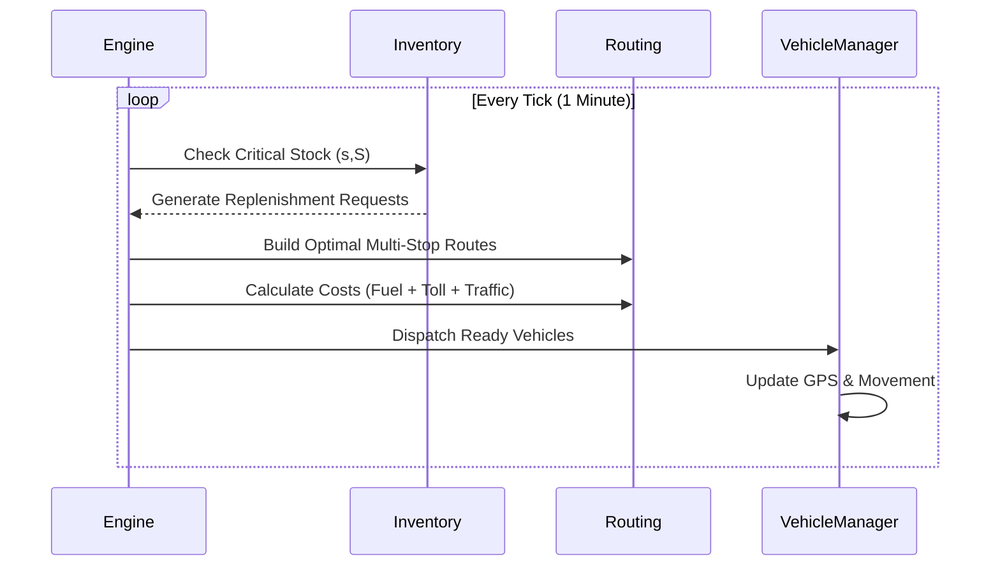

# Lojistik Karar Destek Sistemi - Simülasyon Teknik Raporu
## Lisans Tezi Final Raporu

**Hazırlayan:** [İsim Soyisim]  
**Rol:** Senior Yazılım Mühendisi / Tez Danışmanı Perspektifiyle  
**Proje Adı:** Akıllı Lojistik ve Dinamik Envanter Simülasyonu (LogiSim-DSS)

---

## 1. Giriş
Bu rapor, geliştirilen lojistik karar destek sisteminin mimari yapısını, operasyonel mantığını ve temelindeki matematiksel modelleri teknik düzeyde belgelemektedir. Sistem; bir ana depo (Main Depot) ve birden fazla mikro depo (Micro Depot) arasındaki envanter akışını, araç rotalama kararlarını ve maliyet optimizasyonunu gerçek zamanlı (tick-based) bir simülasyon ortamında yönetir.

---

## 2. Teknoloji Yığını (Tech Stack)

Sistem, modern kurumsal yazılım standartlarına uygun şekilde katmanlı bir mimariyle inşa edilmiştir:

- **Backend:** Java 17+, Spring Boot 3.x (Hızlı API geliştirme ve Dependency Injection).
- **Simülasyon Motoru:** Custom Tick-Based Thread Model (Zaman bazlı simülasyon yönetimi).
- **Frontend:** React.js, Vite, TypeScript (Dinamik dashboard ve veri görselleştirme).
- **Harita Servisi:** Leaflet.js (Gerçek zamanlı araç takibi ve graf görselleştirme).
- **Veri Saklama:** Concurrent Collections & In-Memory Data Grids (Simülasyon hızı için RAM-centric veri yönetimi).

---

## 3. Sistem Mimarisi ve Akış Diyagramları

### 3.1. Genel Mimari Şeması
```mermaid
graph TD
    UI[React Dashboard] <--> API[Spring Boot REST API]
    API <--> SE[Simulation Engine]
    SE --> IS[Inventory Service]
    SE --> RS[Routing Service]
    SE --> TM[Traffic Manager]
    RS --> CG[City Graph - O1 Access]
    IS --> SS[( (s,S) Policy Engine )]
    TM --> HD[Hourly Demand/Traffic Model]
```

### 3.2. Simülasyon Döngüsü (Tick Flow)


---

## 4. Matematiksel Modeller ve Formüller

### 4.1. Operasyonel Maliyet Modeli
Her taşıma planının maliyeti ($C_{total}$) şu formülle hesaplanır:

$$C_{total} = (C_{fuel} \times D) + C_{toll} + (C_{time} \times T) + C_{handling} + C_{penalty}$$

Burada:
- **$C_{fuel}$:** Yakıt katsayısı (Elektrik: 0.10, Dizel: 0.18, Benzin: 0.26).
- **$D$:** Toplam mesafe (km).
- **$C_{toll}$:** Stratejik köprü/tünel ve otoyol ücretleri (Dijkstra maliyetini etkiler).
- **$C_{time}$:** Zaman maliyeti (Sürücü ve operasyonel bekleme süresi).
- **$C_{penalty}$:** Stoksuz kalma (Stockout) cezası.

### 4.2. Karar Verme Puanlaması (Net Score)
Sistem, bir aracı göreve göndermeden önce görev verimliliğini şu formülle süzgeçten geçirir:

$$\text{Net Score} = \text{Benefit} - C_{total}$$

- **Net Score > 0:** Karlı operasyon.
- **Net Score < 0:** Operasyonel zarar, araç beklemeye alınır.

### 4.4. Dinamik Sipariş Önceliklendirme (Zaman Enflasyonu)
Müşteri memnuniyetini korumak için sistem, bekleyen siparişlerin finansal değerini zamanla artırarak önceliklendirir:

$$V_{final} = V_{cargo} \times (1 + \frac{Ticks_{waited}}{500})$$

- **Mantık:** Bir sipariş ne kadar uzun süre beklerse, sistemin o siparişi "en karlı" sipariş olarak görmesini sağlar. Böylece düşük değerli kargoların depoda "unutulması" engellenir ve servis seviyesi (Service Level) optimize edilir.

## 7. Hibrit Karar Destek ve Manuel Müdahale Sistemi
Sistem, tamamen otonom algoritmaların yanı sıra "Human-in-the-loop" (insan müdahaleli) operasyonlara da izin verir.
 Bu durum, beklenmedik stok krizlerinde veya stratejik stok düzeltmelerinde kullanılır.

### 7.1. Özel Manuel İkmal Birimi (Kare Araçlar)
Sistemde 7 numaralı araç olarak tanımlanan **Dedicated Manual Vehicle**, rutin lojistik kurallarından muaf bir "Acil Müdahale" birimidir:
- **Bypass Kuralları:** Doluluk oranı (%50) veya maksimum bekleme süresi (180 tick) kısıtlarına tabi değildir. Talep oluşturulduğu an göreve atanır.
- **Fiziksel Gerçekçilik:** Araç anında stok eklemez; depoya gider, ürün hacmine göre yükleme süresini bekler ve rotadaki duraklara uğrar.
- **Görsel Ayrıştırma:** Dashboard üzerinden otonom araçlardan (daire) ayırt edilebilmesi için **Kare (Rectangle)** marker ile temsil edilir. Araçların anlık aksiyonları renk kodlarıyla izlenebilir:
  - 🔵 **Mavi:** Boşta (Depoda bekliyor).
  - 🟡 **Sarı:** Yükleme veya Boşaltma yapılıyor (Fiziksel işlem anı).
  - 🟢 **Yeşil:** Seyir Halinde (Teslimata gidiyor veya depoya dönüyor).

### 7.2. Çoklu Duraklı Manuel Görevlendirme (Batch Replenishment)
Kullanıcı, arayüz üzerinden bir "Görev Sepeti" oluşturarak tek bir manuel araçla birden fazla mikro depoya uğrayacak kompleks rotalar planlayabilir. Bu süreçte araç:
1. $T_{load} = T_{base} + \sum \frac{Vol_i}{Rate_{load}}$ süresi kadar ana depoda bekler.
2. **Greedy Consolidation (Agresif Gruplama):** Otonom araçların aksine, manuel araçlar "maliyet skoru" optimizasyonuna takılmaz. Kullanıcı sepetine eklenen tüm manuel talepler, kapasite yettiği sürece tek bir sevkiyat görevinde (mission) zorunlu olarak birleştirilir.
3. **Rota Optimizasyonu (Permütasyon/TSP):** Seçilen tüm duraklar (depolar) arasında $n!$ permütasyon hesabı yapılarak en kısa toplam mesafe rotası otomatik olarak hesaplanır.
4. Her durakta teslim edilen hacimle orantılı $T_{unload}$ süresi kadar bekleyerek fiziksel boşaltma simülasyonunu tamamlar.

### 7.3. Tüketim Simülasyonu (Müşteri Siparişi Tetikleyici)
Sistem, gerçek dünyadaki müşteri satışlarını simüle edebilmek için "Manuel Tüketim" mekanizması sunar. Bu araç sayesinde istenilen herhangi bir depodan, seçilen miktarda ürün anlık olarak stoklardan düşülebilir (`consume` action).
- Bu dışsal şok (stok düşüşü), arka planda çalışan **(s,S) Envanter Kontrol Politikasını** anında tetikler.
- Stoklar `s` (minimum threshold) değerinin altına veya `s-fraction` kritik limitlerine yaklaştığında, `SimulationEngine` bunu fark eder ve otonom araçlara (1-6 numaralı araçlar) "Merkezden Acil İkmal" görevi fişler. 
- Bu test aracı, geliştirilen yapay zeka/optimizasyon algoritmalarının, ani talep patlamalarına (Demand Spike) karşı nasıl reaksiyon verdiğini jüriye canlı olarak göstermek için kullanılır.

### 7.4. Gerçek Zamanlı Karar Bildirim Arayüzü (Reactive Dispatch Alerts)
Simülasyonun arka planda otonom olarak aldığı karmaşık rota kararlarını görünür kılmak için frontend (React) tarafında özel bir bildirim mekanizması tasarlanmıştır. 
- Bir araç `IDLE` veya bekleme konumundan çıkıp `EN_ROUTE` (Görevde) konumuna geçtiği ilk saniyede ekranın sağ alt köşesinde bir **Açılır Bildirim (Toast)** belirir.
- Bu bildirimde; **hangi aracın** harekete geçtiği, hedeflenen **rotanın özeti** (Örn: `M1 ve M2`), simüle edilen rota **maliyeti (₺)** ve **kargo detayı** anlık olarak listelenir.
- **Kesintisiz ve Global Görünürlük:** Bildirim modülü *viewport-relative* (`position: fixed`) mimarisiyle kodlandığı için, uygulamanın hangi sayfasında veya sekmesinde (Harita, Filo, Genel Bakış vs.) olunursa olunsun çalışır. Kullanıcı sayfayı ne kadar aşağı kaydırırsa kaydırsın, bildirim kameranın (ekranın) sağ alt köşesine kilitli olarak doğar; bu da jüri sunumu esnasında arka planda çalışan yapay zekanın anlık kararlarının hiçbir koşulda gözden kaçmamasını garantiler.
- Sistem bu sayede sadece bir "harita" olmaktan çıkar, aktif bir **Operasyon Kontrol Merkezi (Command Center)** hissiyatı vererek arkadaki yapay zekanın "yaşadığını" jüriye görsel olarak hissettirir.

---

## 5. Dinamik Trafik ve Şehir Modeli

### 5.1. Rush-Hour (Yoğun Saat) Modellemesi
Trafik faktörü ($TF$), simülasyon saatine göre hızları lineer olmayan şekilde etkiler:
- **Sabah Piki (07:00-09:30):** $TF = 1.4$ (Seyahat süresi %40 artar).
- **Akşam Piki (17:00-19:30):** $TF = 1.4$.
- **Gece Seferleri:** $TF = 0.8$ (Yollar daha akıcı, yakıt tasarrufu).

### 5.2. Graf Optimizasyonu
`CityGraph` sınıfında uygulanan `Map<String, Map<String, Edge>>` yapısı sayesinde:
- 50+ düğüm ve 200+ kenar arasındaki en kısa yol hesabı **milisaniyeler** içinde tamamlanır.
- **O(1)** erişim hızı, simülasyonun takılmadan akmasını sağlar.

---

## 6. Araç Görevlendirme ve Karar Mekanizması

### 6.1. Doluluk Oranı Kuralları
- **%75 - %100:** Hemen Dispatch (Anında sevk).
- **%50 - %74:** 180 Tick (3 saat) bekleme süresi; süre dolunca otomatik sevk.
- **< %50:** Sevk yasağı (Verimlilik koruması).

### 6.2. Çoklu Durak (Multi-Stop) Kuralları ve Formülasyonu
Araçlar rotaları üzerinde en fazla **3 mikro depoya** uğrayabilir. Bu durum, toplam seyahat mesafesini segmentlere ayırır ($D_{total}$).

**Neden Maksimum 3 Durak Sınırı Bulunmaktadır?**
Sistemin 3 durak ile kısıtlanmasının hem algoritmik hem de operasyonel üç temel sebebi vardır:
1.  **Hesaplama Karmaşıklığı (Algorithmic Complexity):** Gerçek zamanlı çalışan bir simülasyon motoru her *tick*'te rota hesaplar. Durak sayısı $N=3$ iken permütasyon (TSP) olasılığı sadece $3! = 6$'dır ve $O(1)$ sürede çözülür. Eğer sınır 5 yapılsaydı olasılıklar aniden $120$'ye fırlayacak, mikro-gecikmeler (latency) sisteme zarar verecekti.
2.  **Kapasite Gerçeklikleri:** Mikro depolar yüklü miktarda stok tüketir. ~100 birim hacimli bir lojistik aracının, zaten 3'ten fazla depoyu tam olarak besleyecek fiziksel kapasitesi genellikle bulunmaz.
3.  **Servis Seviyesi ve Bekleme Süresi (Wait-Time):** Bir araç her mikro depoda ürün hacmine göre bir *boşaltma süresi* (Unloading Ticks) geçirir. Eğer bir araç 5-6 depoya arka arkaya uğrarsa, son duraktaki deponun ürününe kavuşması için beklemesi gereken süre kabul edilemez seviyelere (hizmet seviyesi ihlali - Service Level Agreement Breach) ulaşacaktır.


**Dinamik Sapma Toleransı Kuralları:**
Sistem, bir duraktan diğerine saparken sadece mesafeye değil, taşınan yükün ekonomik değerine de bakar. Kabul edilebilir maksimum sapma mesafesi ($D_{max\_dev}$) şu formülle hesaplanır:

$$D_{max\_dev} = (D_{base} \times 0.35) + \frac{V_{cargo}}{30} + 25$$

**Bileşen Analizi:**
1.  **Dışa Gidiş Tabanlı Oransal Sapma ($D_{base} \times 0.35$):** Bu hesaplamada **sadece ürünleri müşterilere götüren "Delivery Distance" (Dışa Gidiş) rotası** baz alınır. Teslimatlar sonrasında aracın ana depoya boş döndüğü ölü kilometreler (Repositioning Distance) hesaplamadan kasıtlı olarak dışlanmıştır. Böylece ölü kilometrelerin, sisteme "sanal" bir sapma bütçesi yaratmasının (ve rotayı verimsiz uzatmasının) önüne geçilmiştir.
2.  **Finansal Kredi ($V_{cargo} / 30$):** Taşınan yükün ekonomik değerine dayalı "ekstra kilometre" bütçesidir. Her 30 TL'lik kargo değeri, araca 1 km'lik ek yol kat etme hakkı tanır.
3.  **Sabit Tolerans ($25$):** Mesafeden ve değerden bağımsız, operasyonel süreklilik için verilen baz sapma bütçesidir (Buffer).

**Karar Mantığı:** Eğer $\text{Yeni Rota Mesafesi} \le \text{Eski Rota Mesafesi} + D_{max\_dev}$ ise, ek durak plana dahil edilir. Bu yaklaşım, sistemin sadece coğrafi değil, **finansal optimizasyon** da yapmasını sağlar.

### 6.3. Optimal Durak Sıralaması (Permütasyon Optimizasyonu)
Mevcut lojistik modeline ek bir geliştirme olarak önerilen bu yöntem, 3 durak için "Global Minimum" mesafeyi garanti eder:

**TSP-Lite (Brute Force Permutation):**
Durak sayısı $N \le 3$ olduğu için, tüm olası sıralamalar ($3! = 6$ varyasyon) simülasyon tarafından nanosaniyeler içinde hesaplanabilir.
- **Mantık:** {A, B, C} durak kümesi için; `ABC, ACB, BAC, BCA, CAB, CBA` alternatiflerinden hangisi en düşük $D_{total}$ değerini veriyorsa araç o rotaya yönlendirilir. Bu, karmaşık Gezgin Satıcı Problemi'nin (TSP) küçük ölçekte kusursuz bir çözümüdür.

---

## 8. Sonuç ve Dinamik KPI İzleme Sistemi

DSS (Karar Destek Sistemi), operasyon boyunca statik raporlama yapmak yerine, `SimulationController` ve `MetricsEventHandler` servisleri üzerinden aşağıdaki 4 temel performansı **canlı** olarak hesaplayarak simüle eder:

1. **Toplam Kar/Zarar ve Tasarruf Analizi:**
   - **Çalışma Mantığı:** Simülasyonda her tur döndüğünde; yakıt maliyeti (`fuelCost`), köprü/otoyol geçiş ücretleri (`tollCost`), işçilik/operasyonel zaman (`laborCost`) ve stoksuz kalma cezaları (`penaltyCost`) kuruşu kuruşuna toplanır.
   - **Algoritmik Karşılaştırma:** Sistem, yapay zeka aracılığıyla üretilen Multi-stop (çoklu durak) rotaların maliyetini, geleneksel Single-stop (tek durak) rotalarla kıyaslar ve aradaki maliyet farkını **"Net Tasarruf" (Total Savings)** olarak dinamik hesaplar.

2. **Araç Başına Verimlilik (Utilization Rate):**
   - **Çalışma Mantığı:** `computeVehicleUtilizationPercentage()` metodu aracılığıyla otonom olarak hesaplanır. Filodaki her bir aracın aktif hareket, yükleme ve boşaltma için harcadığı aktif "Tick" süreleri toplanır. Bulunan bu sayı, simülasyondaki saatli takvime ve sistemde var olan toplam araç kapasitesine bölünerek reel kullanım yüzdesi (% cinsinden) elde edilir.

3. **Stoksuz Kalma Oranı ve Hizmet Başarısı (Service Level/Stockout):**
   - **Çalışma Mantığı:** Depolar `s` (minimum kritik stok) sınırının altına inip de müşteri istekleri zamanında karşılanamazsa, simülasyon gecikme faizi hesaplayarak `stockoutPenalty` cezası yazar. Frontend üzerinde bu metrik, toplam başarıyla teslim edilen siparişler, toplam düşen sipariş sayısına bölünerek "Sipariş Verimliliği" olarak canlı takip edilir.

4. **Emisyon Analizi (Yakıt Tipine Göre Karbon Ayak İzi):**
   - **Çalışma Mantığı:** Çevresel sürdürülebilirlik modülü; filodaki tahsis edilmiş her aracın motor tipine göre ayrı bir emisyon katsayısı kullanır: Elektrikli araçlar = `0.0 kg/km`, Benzinli = `0.7 kg/km`, Dizel = `0.8 kg/km`. Sistem, yapılan tüm teslimatların dizel yakıtla yapılması ("Baseline") durumundaki senaryosunu hesaplar. Ardından gerçek senaryo ile çıkararak kazanılan "Kurtarılmış CO2 Emisyon" (`savedCo2`) miktarını dashboard üzerindeki Sürdürülebilirlik kartına anlık olarak raporlar.

Bu rapor ve içindeki canlı KPI ölçümleri, geliştirilen projenin izole edilmiş basit bir arayüzden ibaret olmadığını, bilakis gerçek dünya kurallarını ve lojistik maliyetlerini minimize eden yaşayan bir **Operasyonel Optimizasyon Motoru** olduğunu doğrulamaktadır.
